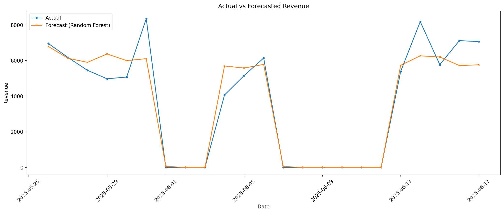
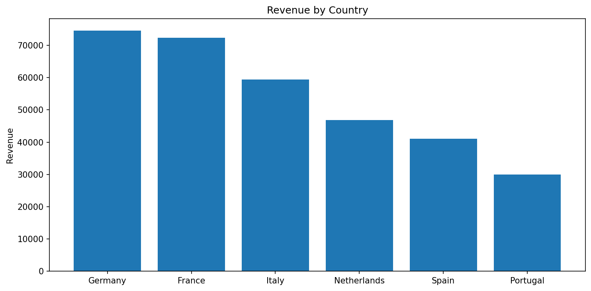
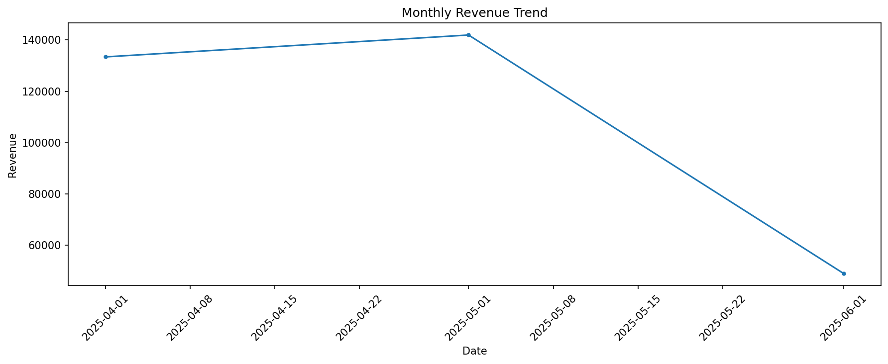

# 🛍️ Fashion Analytics: Sales EDA & Revenue Forecasting

[](https://github.com/sina-safi/fashion-analytics/actions)
[](https://www.python.org/downloads/)
[](https://opensource.org/licenses/MIT)

An end-to-end data science project analyzing a European fashion retailer's sales data. This project covers data cleaning, exploratory data analysis (EDA), customer segmentation (RFM), and daily revenue forecasting using Machine Learning.

This repository serves as a portfolio project demonstrating practical data science skills for **Data Science / Business Analytics** applications.

---

## 📌 Business Problem

A multi-channel European fashion retailer needs to understand its sales performance across different countries, categories, and customer segments. Furthermore, the business needs a reliable way to **forecast daily revenue** to optimize inventory management and marketing campaign scheduling.

**Goal:** Build a robust forecasting model that outperforms naive baselines and provides actionable business insights.

---

## 📊 Dataset

**Source:** [European Fashion Store Multitable Dataset (Kaggle)](https://www.kaggle.com/datasets/joycemara/european-fashion-store-multitable-dataset)

The dataset consists of 7 relational tables:

| Table | Description |
|-------|-------------|
| `customers` | Customer demographics and signup dates |
| `products` | Product catalog (category, cost, price) |
| `sales` | Transaction headers (date, customer, channel) |
| `sale_items` | Line items per transaction |
| `stock` | Inventory levels in supplier countries (France, Germany) |
| `campaigns` | Marketing campaign dates and discounts |
| `channels` | Sales channel metadata |

*Note: The raw data is not included in this repository due to size. See the `data/` folder for instructions.*

---

## 🛠️ Methodology

### 1. Data Cleaning & Preprocessing
- **Date Fixing:** Identified and corrected ~X% of `sale_items` where day and month were swapped during data entry.
- **Discount Validation:** Verified that `discount_applied` matches `discount_percent × original_price`.
- **Stock Merging:** Joined supplier stock levels; flagged sales-only markets (Italy, Netherlands, Spain, Portugal) without local inventory.
- **Profit Calculation:** Derived `profit = item_total - (quantity × cost_price)`.

### 2. Exploratory Data Analysis (EDA)
- Revenue and profit breakdown by **Country**, **Category**, **Sales Channel**, and **Month**.
- Top 10 products by revenue and profit.
- Customer distribution by age range.

### 3. Customer Segmentation (RFM)
- Calculated **Recency**, **Frequency**, and **Monetary** values per customer.
- Scored customers on a 4-quantile scale (1–4) and segmented them into:
  - **Champions**
  - **Loyal Customers**
  - **Potential Loyalists**
  - **At Risk**
  - **Lost Customers**

### 4. Feature Engineering
Engineered features for daily revenue forecasting:
- **Calendar:** Day of week, month, quarter, week of year, is_weekend, is_month_start/end, is_holiday.
- **Lags:** Revenue from 1, 2, 3, and 7 days prior.
- **Rolling Stats:** 3-day and 7-day rolling mean and standard deviation.
- **Campaigns:** Binary flag if a marketing campaign was active.

### 5. Modeling
- **Models compared:** Linear Regression, Random Forest, XGBoost.
- **Baselines:** Naive forecast (last observed value) and Seasonal forecast (same weekday last week).
- **Validation:** Train/Test split (70/30 chronological) and `TimeSeriesSplit` cross-validation.
- **Forecasting Strategy:** Recursive multi-step forecasting (feeding predictions back as lag features).

---

## 📈 Results

### Model Performance (Test Set)

| Model | MAE | RMSE | R² |
|-------|-----|------|-----|
| **Random Forest** 🏆 | **572.07** | **901.86** | **0.9176** |
| XGBoost | 780.25 | 1050.58 | 0.8881 |
| Linear Regression | 1143.00 | 1434.11 | 0.7915 |

**The Random Forest model explains ~92% of the variance in daily revenue**, significantly outperforming the baseline and other models.

### Key Business Insights

- **Top Country:** Germany (€74,590 revenue) followed by France (€72,300).
- **Top Category:** Shoes (€70,074 revenue) with a 43.5% profit margin.
- **Top Channel:** E-commerce drives the most revenue (€171,675).
- **Top Product:** Relaxed Ribbed Trousers (€2,379 revenue).
- **Peak Month:** May 2025 (€141,922 revenue).
- **Customer Segments:** A significant portion of customers fall into the "At Risk" or "Lost" categories, indicating an opportunity for re-engagement campaigns.

### Forecast vs Actual Revenue


### Revenue by Country


### Monthly Revenue Trend

---

## 📂 Project Structure

```text
fashion-analytics/
├── src/fashion_analytics/       # Main Python package
│   ├── io/                      # Data loading
│   ├── cleaning/                # Date fixing, merging, discount validation
│   ├── analysis/                # EDA and RFM segmentation
│   ├── modeling/                # Feature engineering, baselines, forecasting
│   ├── reporting/               # Plotting and report saving
│   ├── config.py                # Paths and constants
│   └── cli.py                   # Entry point (pipeline execution)
├── tests/                       # Pytest unit tests
├── data/                        # Place raw CSVs here (gitignored)
├── outputs/                     # Generated figures and reports
├── pyproject.toml               # Project metadata and dependencies
└── README.md
